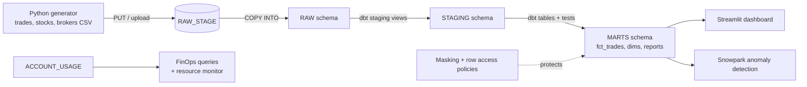

# SettleWatch: Trade Settlement Analytics on Snowflake

A Snowflake data warehouse for simulated US equity trades. It tracks which trades
**fail to settle on time (T+1)**, and shows how the warehouse was tuned to run
faster, cost less and keep sensitive data secure.

**Stack:** Snowflake · SQL · dbt · Python · Snowpark · Streamlit

## Why this project

When a stock is bought, the cash and shares must change hands one business day
later (**T+1**, required in the US since May 2024). When that doesn't happen, the
trade **fails**, which creates risk and cost for everyone involved. SettleWatch
loads trade data, models it into a star schema, reports fail rates by broker and
reason, and then works on the platform itself: query performance, cost
monitoring (FinOps) and data governance.

## Architecture



**Data model (star schema)**

| Table | Grain | What it holds |
|---|---|---|
| `fct_trades` | one row per trade | quantity, price, notional, status, fail reason |
| `dim_stock` | one row per stock | company, sector, exchange |
| `dim_broker` | one row per broker | name, region |
| `dim_date` | one row per day | year, month, weekday, business-day flag |
| `rpt_daily_fails` | day × broker | trades, fails, fail rate, failed notional |
| `rpt_fail_reasons` | month × broker × reason | why trades fail |
| `rpt_broker_scorecard` | broker | fail rate vs. average, `needs_review` flag |

## Project layout

```
settlewatch/
├── data_generator/generate_trades.py   # makes the fake CSVs (standard library only)
├── data/                               # CSVs land here (git-ignored)
├── setup/                              # Step 1-2: warehouse, database, load data
├── dbt/                                # Step 3-4: models and tests
├── performance/                        # Step 5: clustering, query profiles, TUNING_LOG.md
├── finops/                             # Step 6: cost monitoring, resource monitor, sizing
├── governance/                         # Step 7: roles, masking, row access, audit
└── optional/                           # Snowpark procedure, Streamlit dashboard
```

## How to run it

You need a free [Snowflake trial](https://signup.snowflake.com/) (choose
**Enterprise** edition and **AWS**), a free [dbt Cloud](https://www.getdbt.com/signup)
developer account, and Python 3.

### Step 1: set up Snowflake
Open a Snowsight worksheet, paste `setup/01_setup.sql`, and click **Run All**.

### Step 2: create and load the data
```bash
python data_generator/generate_trades.py
```
This writes `data/trades.csv` (100,000 trades), `data/stocks.csv` and
`data/brokers.csv`. Upload the three files to the stage (Snowsight: Data >
Databases > SETTLEWATCH > RAW > Stages > RAW_STAGE > **+ Files**), then run
`setup/02_load_raw_data.sql`. You should see 20 stocks, 8 brokers and 100,000 trades.

### Step 3-4: build and test with dbt
1. In dbt Cloud, create a project, connect it to Snowflake (role `SYSADMIN`,
   warehouse `TRANSFORM_WH`, database `SETTLEWATCH`) and to this GitHub repo.
2. Set the project subdirectory to `dbt`.
3. In the dbt Cloud IDE run:
   ```
   dbt build
   ```
   This builds 10 models and runs 33 tests (uniqueness, relationships,
   accepted values, plus custom tests for T+1 settlement dates and fail reasons).

Using dbt Core on your laptop instead? `pip install dbt-snowflake`, copy
`dbt/profiles.yml.example` to `~/.dbt/profiles.yml`, fill it in, and run
`dbt build` from the `dbt/` folder.

### Step 5: performance tuning
Run the files in `performance/` in order:

| Script | What it does |
|---|---|
| `01_create_big_table.sql` | Copies `fct_trades` 500× into a ~50M-row, shuffled table |
| `02_benchmark_queries.sql` | Runs 4 report queries and measures runtime and partitions scanned |
| `03_add_clustering.sql` | Builds a copy clustered on `(trade_date, broker_id)` |
| `02_benchmark_queries.sql` again | With `SET tbl = 'FCT_TRADES_BIG_CLUSTERED';` |
| `04_search_optimization.sql` | Optional: speeds up single-trade lookups |
| `05_cleanup.sql` | Drops the big tables when you're done |

Record every number in [`performance/TUNING_LOG.md`](performance/TUNING_LOG.md).

### Step 6: FinOps (cost)
Run `finops/01` to `05` (as ACCOUNTADMIN): credits per warehouse and day, cost
per dbt model (via query tags), slow / full-scan / spilling / queued queries, a
monthly resource monitor, and an XS vs S vs M sizing test.

### Step 7: governance
Run `governance/01` to `04`: roles (`DATA_ENGINEER`, `ANALYST`, `AUDITOR`),
masking of account numbers, region-based row access, and a test script that
proves each role sees only what it should. From then on, build with
```
dbt build --vars '{apply_masking: true, apply_row_access: true}'
```
so the policies are re-applied whenever dbt rebuilds the tables.

### Optional extras
- `optional/snowpark_fail_anomalies.sql`: Python stored procedure that flags
  broker-days whose fail rate is far above their 20-day average (z-score).
- `optional/streamlit_app.py`: dashboard for Streamlit in Snowflake (fail rates,
  broker scorecard, fail reasons, credits used).

## Results

Fill these in from your own runs.

| Metric | Before | After |
|---|---|---|
| Q1 runtime (fail rate, one month) | ___ s | ___ s |
| Q1 partitions scanned | ___ % | ___ % |
| Clustering depth on `trade_date` | ___ | ___ |
| Daily credits for the pipeline | ___ | ___ |

## Keeping it free

- Every warehouse is XS with `AUTO_SUSPEND = 60`.
- The resource monitor suspends warehouses at 20 credits a month.
- Run `performance/05_cleanup.sql` when you finish the tuning step.
